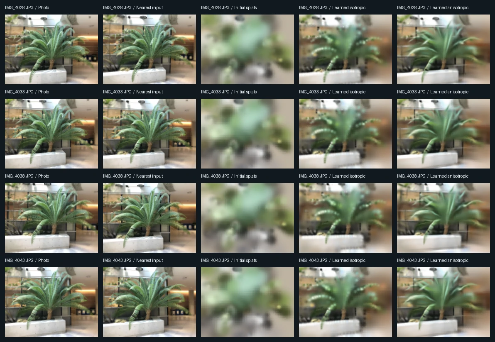

# Multi-view Gaussian Reconstruction

A CPU-first PyTorch implementation of 3D Gaussian splatting from calibrated photos. It initializes a scene by triangulating training-image features, learns the Gaussian parameters through image reconstruction, and renders new views at four held-out camera poses.



Each row shows a different camera. Learned columns use seed 17. Photos were resized and undistorted. Dataset attribution is below.

## Measured results

LLFF Fern, 16 training photos and 4 interleaved held-out photos. All methods render or predict at 112 × 84 pixels. Both learned variants start from the same 900 points, run 500 Adam updates and use the same three seeds. The nearest-view baseline copies the training image with the closest camera center.

| Method | Held-out PSNR ↑ | Held-out SSIM ↑ | Fit time |
| --- | ---: | ---: | ---: |
| Nearest training view | 17.54 dB | 0.425 | — |
| Initial Gaussian splats | 13.11 dB | 0.219 | — |
| Learned isotropic splats | 22.38 ± 0.08 dB | 0.701 ± 0.001 | 22.6 s |
| Learned anisotropic splats | **23.67 ± 0.16 dB** | **0.784 ± 0.006** | 24.4 s |

Metrics are averaged per view, then per seed for trained methods. The ± values are population standard deviations across seeds. Fit time is mean optimization wall time with PyTorch configured for four CPU threads. It excludes image loading, feature matching, and evaluation. See the [per-view scores, split, and training traces](reports/metrics.json).

Anisotropy added 1.28 dB over the learned isotropic control on this scene. The images show better leaf outlines, with remaining blur on thin leaves and the background. This experiment covers one scene, nearby novel viewpoints, and a small rendering resolution.

## Method

1. **Prepare calibrated inputs.** Read intrinsics and world-to-camera poses from the provided COLMAP reconstruction, resize and undistort RGB photos, and hold out every fifth registered image starting at index 2 after sorting names.
2. **Recover sparse geometry from training images.** Detect SIFT features, match nearby training views with mutual ratio checks, triangulate with calibrated projection matrices, and filter by positive depth, parallax, and reprojection error. The initialization uses no supplied COLMAP 3D points or held-out pixels.
3. **Render and optimize.** Project each 3D covariance to the image plane with the local perspective Jacobian. Rasterize its finite support and composite front-to-back by depth per pixel. Use PyTorch autograd to fit centers, scales, colors, opacities and, for the anisotropic model, orientations.
4. **Evaluate novel views.** Keep the input calibration fixed and score predictions against the four reserved RGB images. The distributed camera poses were originally estimated with the full capture, so this tests novel-view rendering given calibration.

The renderer uses a fixed number of Gaussians, view-independent RGB and CPU tensor operations. The experiment does not estimate camera poses or implement the original paper’s adaptive density control or CUDA rasterizer.

## Render the saved scene

Requires Python 3.11 or newer. The reference run used Python 3.12 and PyTorch 2.7.1 CPU.

```bash
python -m venv .venv
source .venv/bin/activate
pip install 'torch==2.7.1+cpu' --index-url https://download.pytorch.org/whl/cpu
pip install -e .

multiview3d-preview \
  --scene reports/anisotropic_scene.npz \
  --cameras reports/test_cameras.json \
  --output runs/preview
```

The command writes the four renderings without downloading the original photos. The scene file stores centers, scales and rotations in COLMAP coordinates, plus RGB and opacity. The camera manifest stores image dimensions, pinhole intrinsics and world-to-camera poses.

## Reproduce the benchmark

```bash
mkdir -p data
curl -fL -o data/fern.zip \
  'https://huggingface.co/datasets/nerfbaselines/nerfbaselines-data/resolve/main/llff/fern.zip'
echo '1b34fc4287cbdca104184284647d4368e7d7dc262080a054e07abe76506742be  data/fern.zip' | sha256sum -c -
unzip -q data/fern.zip -d data

multiview3d --data data/fern --output runs/fern
python -m unittest discover -s tests -v
```

The full run saves an RGB comparison grid, metrics JSON, camera manifest and a representative checkpoint for each Gaussian variant. The tests check the view split, triangulation, projected anisotropy, compositing and render gradients.

## References and data attribution

- Gaussian projection and visibility-aware rendering follow the principles in Kerbl et al., *3D Gaussian Splatting for Real-Time Radiance Field Rendering*, SIGGRAPH 2023. [Paper](https://arxiv.org/abs/2308.04079)
- The reference photos and camera poses come from the Fern capture of Mildenhall, Srinivasan, Ortiz-Cayon, Kalantari, Ramamoorthi, Ng and Kar, *Local Light Field Fusion*, SIGGRAPH 2019. The downloaded archive includes its [CC BY 3.0 license](https://creativecommons.org/licenses/by/3.0/). The comparison gallery contains resized and undistorted versions of these photos. [Original project](https://bmild.github.io/llff/) · [Dataset archive](https://huggingface.co/datasets/nerfbaselines/nerfbaselines-data/blob/main/llff/fern.zip)
